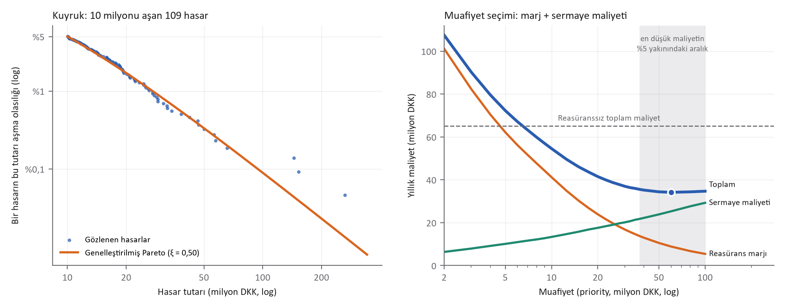

# Reasürans Dilimini Nereye Koymalı?
*Danimarka yangın hasarlarıyla hasar fazlası (XL) muafiyetinin uç değer analizi*

*Mehmet Ali Kaya · Veri Yönetimi Uzmanı, Yönetim Bilişim Sistemleri Doktora Adayı, İstatistik Yüksek Lisans*

**On bir yılın 2.167 yangın hasarıyla hasar fazlası korumasının muafiyetini hesapladım. Doğru muafiyet tek bir sayı değil, 37,5–100 milyon DKK arasında geniş ve düz bir vadi; asıl risk, vadinin yerini geçmiş veriden okurken trendi unutmak.**

## Veri ve problem

Veri, uç değer literatürünün klasiği danishuni: Copenhagen Re'ye 1980–1990 arasında bildirilen, 1 milyon DKK'yı aşan 2.167 ticari yangın hasarı, 1985 fiyatlarına enflasyonla düzeltilmiş (CASdatasets, GPL). Medyan hasar 1,78, ortalama 3,39, en büyüğü 263 milyon DKK. Soru, her aktüerin reasürans yenilemesinde sorduğu soru: Risk başına hasar fazlası (XL) korumasının muafiyetini nereye koymalı? Muafiyet düşerse reasürans pahalanır; yükselirse şirket büyük hasarı kendi sermayesiyle taşır.

## Model ve bulgular

10 milyon DKK eşiğini aşan 109 hasara Genelleştirilmiş Pareto dağılımı uydurdum: kuyruk parametresi ξ = 0,50 (bootstrap güven aralığı 0,13–0,79; Hill tahmini 0,63; eşiğe göre 0,45–0,68). Model, geçmiş yılların gerçekleşen devrini (burning cost) yakından izliyor; 10 milyon muafiyette yıllık beklenen devir 137,4, gerçekleşen 139,5 milyon DKK.

Muafiyeti seçmek için iki maliyeti topladım: reasürörün beklenen devir üzerindeki yüzde 30 marjı ve şirketin elde kalan yıllık hasarı için tuttuğu sermayenin yüzde 10'luk maliyeti (sermaye: 50.000 simüle yılda yüzde 99,5 VaR eksi ortalama). Toplam maliyet 60 milyon DKK muafiyette en düşük: yılda 34,2 milyon DKK; reasüranssız 65,1 milyonun yüzde 48 altında. Ama eğri düz: Marj yüzde 20–50, sermaye maliyeti yüzde 6–10 arasında değiştiğinde en iyi muafiyet 40 ile 100 milyon arasında geziyor. Üstelik 60 milyon muafiyetteki beklenen devrin güven aralığı 2,1–164 milyon DKK; kuyruğun ucu belirsiz.

Son olarak modeli zamana karşı sınadım: 1980–1987 verisiyle kurup 1988–1990'ı tahmin ettirdim. 10 milyon muafiyette beklenen yıllık devir 107, gerçekleşen 213 milyon; simülasyonların yalnızca yüzde 3,9'i bu kadar kötü. Sebep frekans: Yıllık hasar sayısı 188'den 221'e çıktı. 30 milyon muafiyette ise sonuç tahmin aralığının içinde kaldı (simülasyonların yüzde 8,2'i).

| Muafiyet (milyon DKK) | Beklenen devir (model) | Burning cost | Elde kalan sermaye | Toplam maliyet |
|---|---|---|---|---|
| 5 | 207,3 | 209,4 | 101 | 72,3 |
| 10 | 137,4 | 139,5 | 133 | 54,6 |
| 30 | 56,1 | 58,5 | 201 | 37,0 |
| 60 | 29,6 | 35,1 | 253 | 34,2 |
| 100 | 18,1 | 23,7 | 293 | 34,7 |
| Reasüranssız | 0 | 0 | 651 | 65,1 |

## Sektör için tek ders

Muafiyet seçimi bir noktayı değil bir aralığı hedeflemeli; aralığın içindeki son karar sermaye iştahına ve reasürans fiyatına bağlı. Asıl tehlike alt dilimlerde: Frekans trendi modele girmezse, en çok prim ödenen alt dilimlerin maliyeti sistematik olarak düşük görünür. Grafikteki en büyük üç hasarın Pareto çizgisinin üstünde durması da en üst dilimin modelden bile ağır olabileceğini hatırlatıyor.

- Kod: https://github.com/000MAK/cafepolice-reinsurance-priority
- Sonuçlar: https://huggingface.co/makactuary/danish-fire-xl-priority
